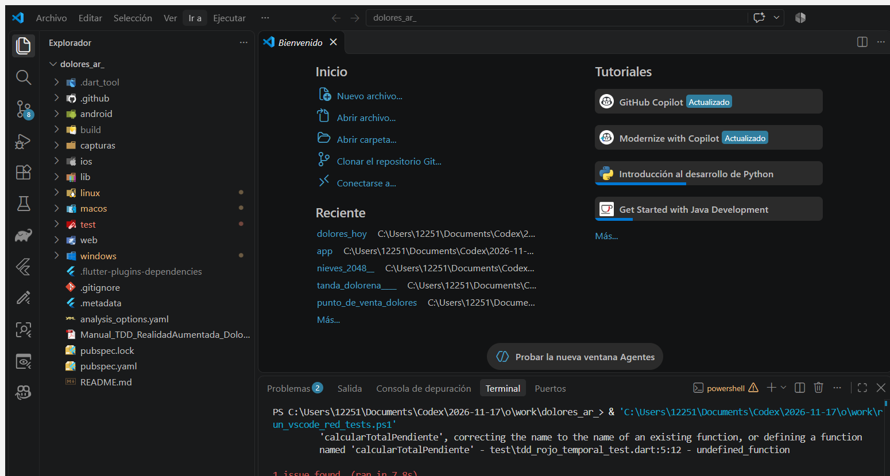
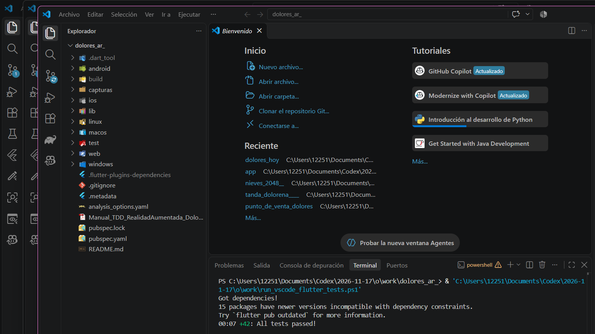

# Dolores AR

Aplicación de Flutter sobre lugares turísticos de Dolores Hidalgo usando realidad aumentada.

La app permite:

- Ver lugares cercanos.
- Calcular distancia y dirección.
- Mostrar etiquetas sobre la cámara.
- Guardar sellos en un pasaporte turístico.
- Usar un modo de demostración.

## Captura de la aplicación


## Cómo ejecutarlo

```bash
flutter pub get
flutter run
```

## Pruebas

Primero hice una ejecución con una función faltante para mostrar la fase roja. Después quité esa prueba temporal y ejecuté todas las pruebas del proyecto.

```bash
flutter test
```

| Prueba con error | Pruebas terminadas |
|---|---|
|  |  |

Resultado final: **42 pruebas aprobadas**.
