# 🧭 Dolores AR

App turística con **realidad aumentada** para visitar **Dolores Hidalgo, Guanajuato**, desarrollada en **Flutter** con **TDD** (Desarrollo Guiado por Pruebas).

> Desarrollo Móvil Integral · UTNG · Prof. Anastacio Rodríguez García

<p align="center">
  
</p>

---

## 📖 Descripción

Al levantar el teléfono en la Plaza Principal, la app muestra etiquetas flotando sobre la cámara: *"Parroquia de Nuestra Señora de los Dolores, 120 m"*, *"Nieves del Jardín, 25 m"*. Al girar, las etiquetas se desplazan; al tocar una, se muestra su historia.

La app incluye dos tipos de realidad aumentada:

| Tipo | Cómo funciona |
|------|---------------|
| **RA por ubicación** (núcleo del proyecto) | GPS + brújula + cámara. Todo se calcula con trigonometría, por eso es ideal para TDD. |
| **RA de superficie** | Coloca un modelo 3D (`.glb`) sobre el piso o una mesa con ARCore (Android) y Quick Look (iPhone), usando `model_viewer_plus`. |

---

## ✨ Características

- 📍 Distancia entre coordenadas GPS con la **fórmula de Haversine**.
- 🧭 **Rumbo** inicial y manejo del salto de ángulos 359° → 1°.
- 📐 Conversión de ángulo a posición en pantalla con el **campo de visión (FOV)**.
- 🎚️ **Filtro pasa-bajas circular** para que las etiquetas no tiemblen.
- 🏷️ Etiquetas con **escala y profundidad** (lo lejano es más pequeño y sube al horizonte).
- 🛂 **Pasaporte turístico**: ganas un sello al estar a ≤ 40 m de un lugar.
- 🎓 **Modo demo** con deslizador de brújula, para practicar en el salón sin estar en Dolores Hidalgo.
- 🧊 Visor de **modelo 3D** en realidad aumentada.
- 🔒 Privacidad y seguridad: permiso de ubicación mínimo, errores sin detalles internos, aviso de seguridad física.

---

## 🧰 Tecnologías

- [Flutter](https://flutter.dev) / Dart (SDK `>=3.0.0 <4.0.0`)
- [`camera`](https://pub.dev/packages/camera): cámara trasera
- [`geolocator`](https://pub.dev/packages/geolocator): posición GPS y permisos
- [`flutter_compass`](https://pub.dev/packages/flutter_compass): rumbo del teléfono
- [`model_viewer_plus`](https://pub.dev/packages/model_viewer_plus): modelos 3D y RA

---

## 🗂️ Estructura del proyecto

```
dolores_ar/
├── lib/
│   ├── dominio/                  # Matemáticas y reglas (Dart puro, sin plugins)
│   │   ├── geo.dart              # distancia, rumbo, ángulos, campo de visión
│   │   ├── lugar.dart
│   │   ├── catalogo.dart         # 7 lugares de Dolores Hidalgo
│   │   ├── motor_ar.dart         # ¿qué se ve y dónde?
│   │   ├── pasaporte.dart        # sellos por visitar lugares
│   │   ├── fuentes.dart          # contratos: FuentePosicion, FuenteBrujula
│   │   └── excepciones.dart
│   ├── datos/
│   │   ├── fuentes_reales.dart   # geolocator + flutter_compass
│   │   └── fuentes_simuladas.dart# MODO DEMO (sin GPS)
│   ├── presentacion/
│   │   ├── ar_viewmodel.dart
│   │   ├── fondo_camara.dart
│   │   ├── pantalla_ar.dart
│   │   ├── pantalla_modelo3d.dart
│   │   └── pantalla_inicio.dart
│   └── main.dart
└── test/
    ├── geo_test.dart
    ├── motor_ar_test.dart
    ├── pasaporte_test.dart
    ├── ar_viewmodel_test.dart
    └── ayudas_geo.dart
```

---

## 🔁 Ciclo TDD

1. 🔴 **ROJO**: escribe la prueba (debe fallar).
2. 🟢 **VERDE**: escribe el código mínimo para que pase.
3. 🔵 **REFACTOR**: ordena el código sin romper nada.

Como la matemática y las fuentes de datos están detrás de contratos (interfaces), las pruebas simulan cualquier posición y rumbo sin salir a caminar y corren en milisegundos.

---

## 🚀 Instalación

```bash
flutter create dolores_ar
cd dolores_ar
flutter pub add camera geolocator flutter_compass model_viewer_plus
mkdir lib/dominio lib/datos lib/presentacion
```

Borra `test/widget_test.dart` y ejecuta:

```bash
flutter pub get
```

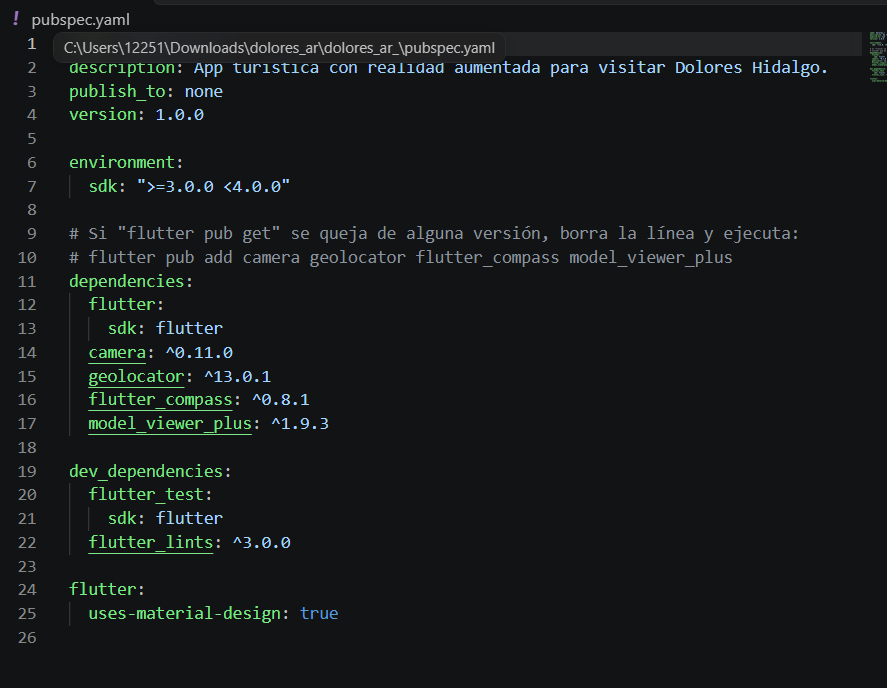

### Permisos en Android

En `android/app/src/main/AndroidManifest.xml`, dentro de `<manifest>` y **antes** de `<application>`:

```xml
<uses-permission android:name="android.permission.INTERNET"/>
<uses-permission android:name="android.permission.CAMERA"/>
<uses-permission android:name="android.permission.ACCESS_FINE_LOCATION"/>
<uses-permission android:name="android.permission.ACCESS_COARSE_LOCATION"/>
<uses-feature android:name="android.hardware.camera" android:required="false"/>
```

Y en `android/app/build.gradle` verifica `minSdkVersion 24` (mínimo 21).

### Permisos en iPhone

En `ios/Runner/Info.plist`:

```xml
<key>NSCameraUsageDescription</key>
<string>Usamos la cámara para mostrarte los lugares históricos a tu alrededor.</string>
<key>NSLocationWhenInUseUsageDescription</key>
<string>Usamos tu ubicación solo mientras la app está abierta, para saber qué lugares tienes cerca.</string>
```

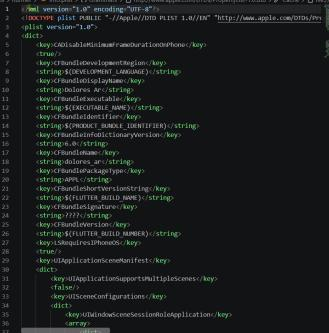

> Se pide ubicación **"solo mientras se usa la app"** (principio de mínimo privilegio).

---

## ▶️ Ejecutar

```bash
flutter test      # corre todas las pruebas
flutter run       # abre la app
```

> La brújula y la cámara no existen en la mayoría de los emuladores. Usa un teléfono real o el **Modo demo**.

---

## 🧪 Desarrollo por rondas

### Ronda 1 · Distancia (Haversine)

Un grado de longitud no mide lo mismo en todas partes, así que Pitágoras no sirve. Haversine calcula la distancia por la superficie de la esfera.

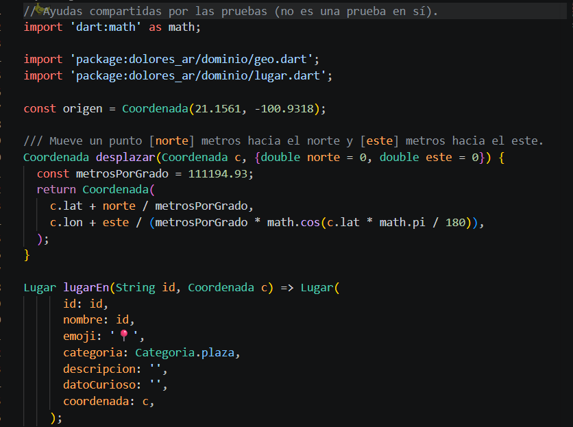
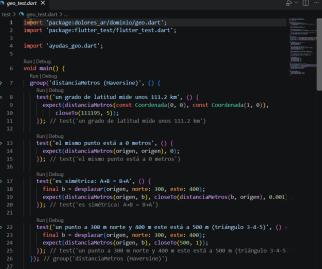
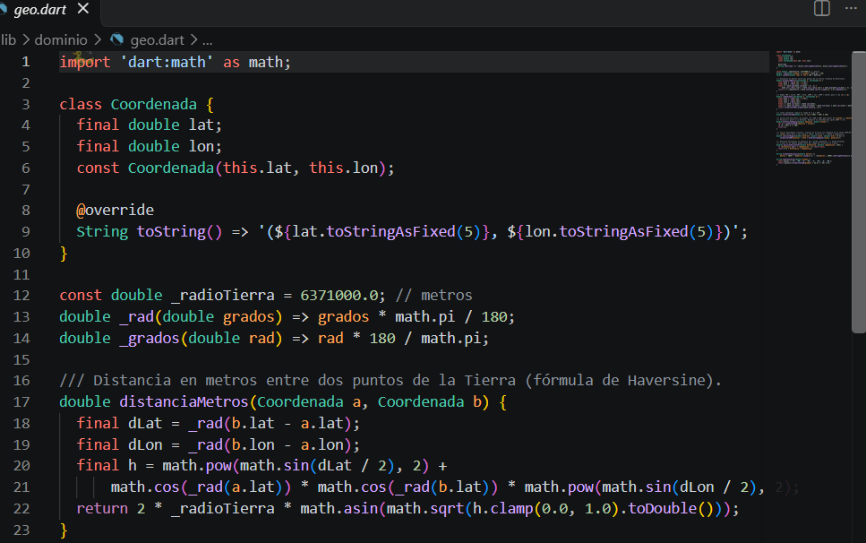

### Ronda 2 · Rumbo y ángulos

El rumbo se mide desde el norte (N = 0°, E = 90°, S = 180°, O = 270°). El bug clásico es el salto 359° → 1°, resuelto con `diferenciaAngular` y `suavizarAngulo`.

> ⚠️ Nunca promedies ángulos directamente: el promedio de 350° y 10° da 180° en lugar de 0°.

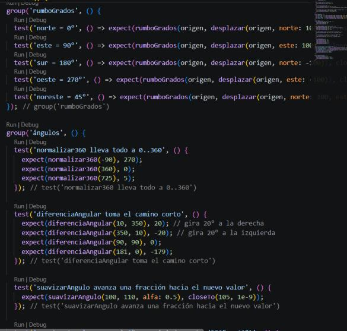
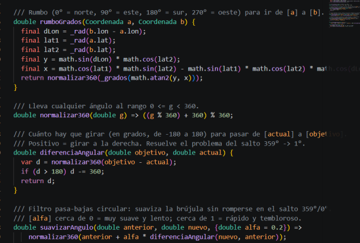

### Ronda 3 · Campo de visión y lugares

`x = 0.5 + diferencia / campoVision`. Si `|diferencia| > campoVision / 2`, el lugar no se dibuja (`null`).

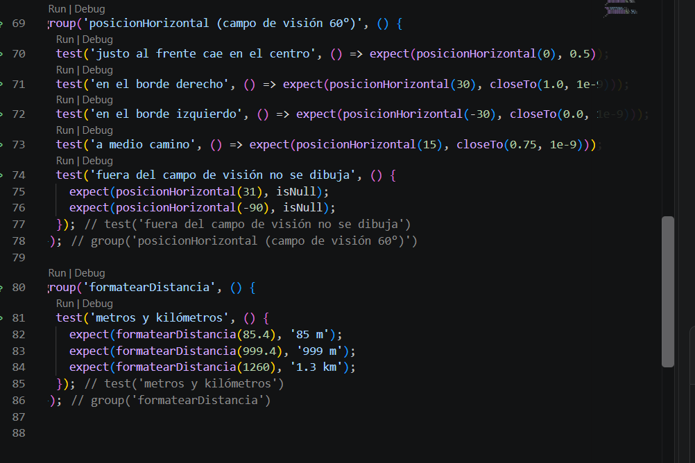
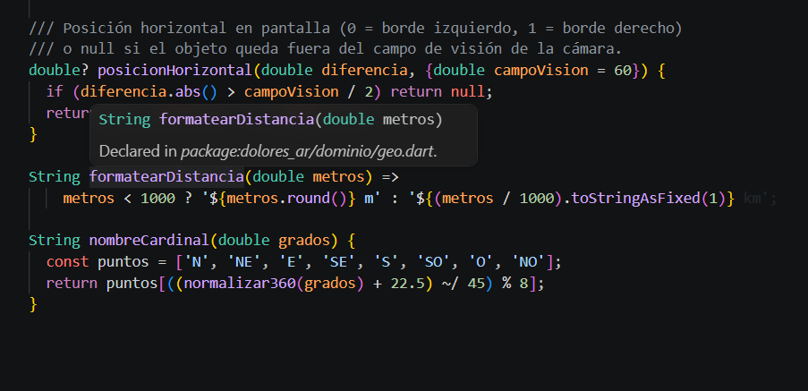
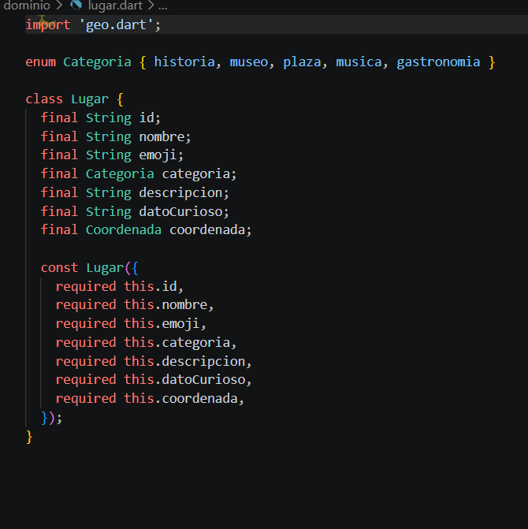
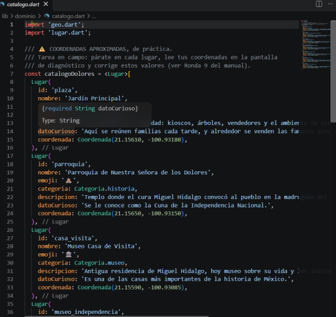

**Lugares del catálogo:**

| Emoji | Lugar | Categoría |
|:-----:|-------|-----------|
| 🌳 | Jardín Principal | Plaza |
| ⛪ | Parroquia de Nuestra Señora de los Dolores | Historia |
| 🏛️ | Museo Casa de Visita | Museo |
| 📜 | Museo de la Independencia Nacional | Museo |
| 🎺 | Museo José Alfredo Jiménez | Música |
| 🍦 | Nieves del Jardín | Gastronomía |
| 🌹 | Tumba de José Alfredo Jiménez | Música |

> ⚠️ Las coordenadas son **aproximadas** y de práctica. Deben corregirse con un recorrido de campo (ver [Prueba de campo](#-prueba-de-campo)).

### Ronda 4 · Motor de realidad aumentada

`calcularVisibles(...)` es una **función pura**: recibe posición, rumbo y lugares, y devuelve los lugares visibles con su `x`, distancia, profundidad y escala, ordenados de lejos a cerca.

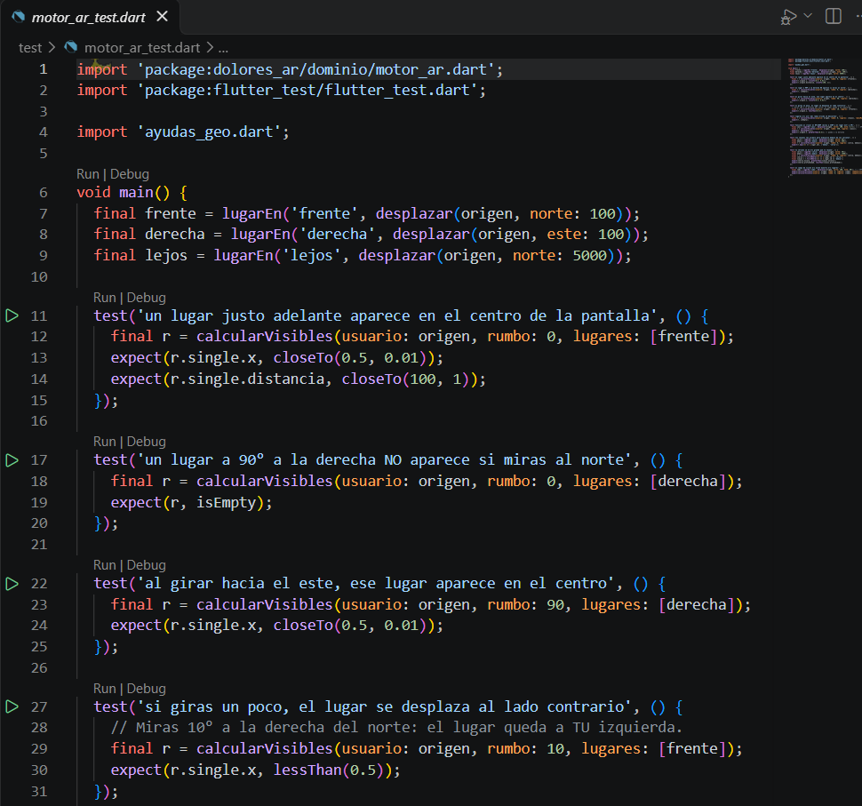
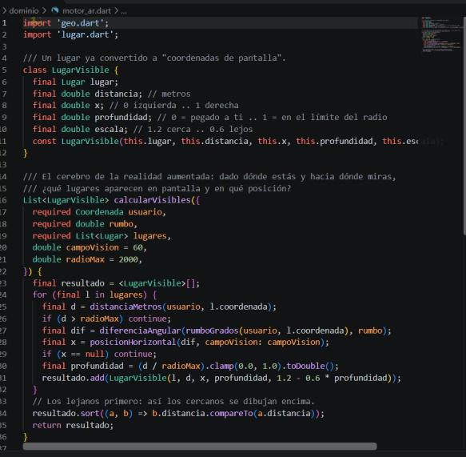

### Ronda 5 · Pasaporte turístico

Al llegar a **40 m o menos** de un lugar se gana su sello, una sola vez (gracias a `Set.add()`).

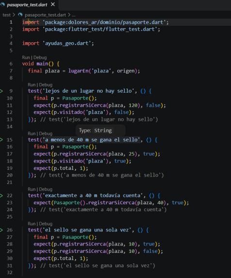
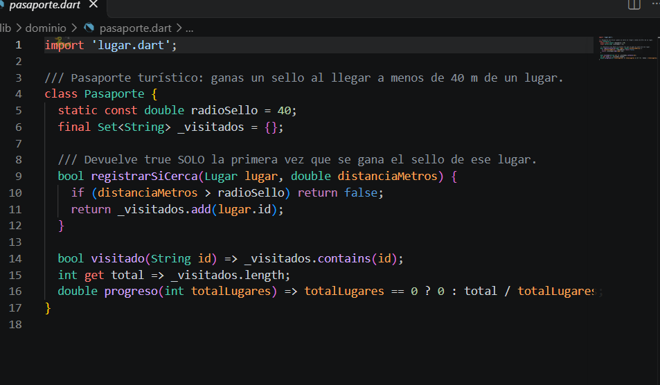

> El GPS de un teléfono tiene un error típico de 5 a 20 m, por eso el radio es de 40 m y no de 5 m.

### Ronda 6 · Fuentes de datos y ViewModel

`ArViewModel` depende de los contratos `FuentePosicion` y `FuenteBrujula`, no de `Geolocator`. Eso permite tres implementaciones:

```
          FuentePosicion (contrato)
         /          |            \
  PosicionGps  PosicionSimulada  PosicionFalsa
  (teléfono)    (modo demo)       (pruebas)
```

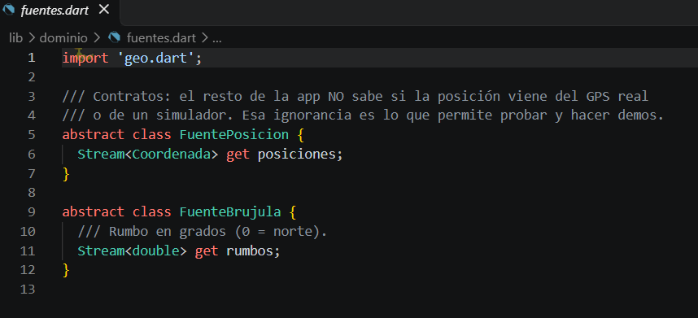
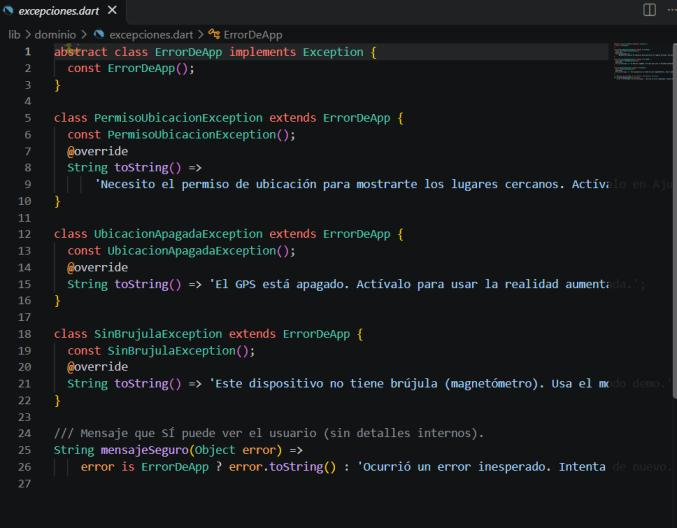
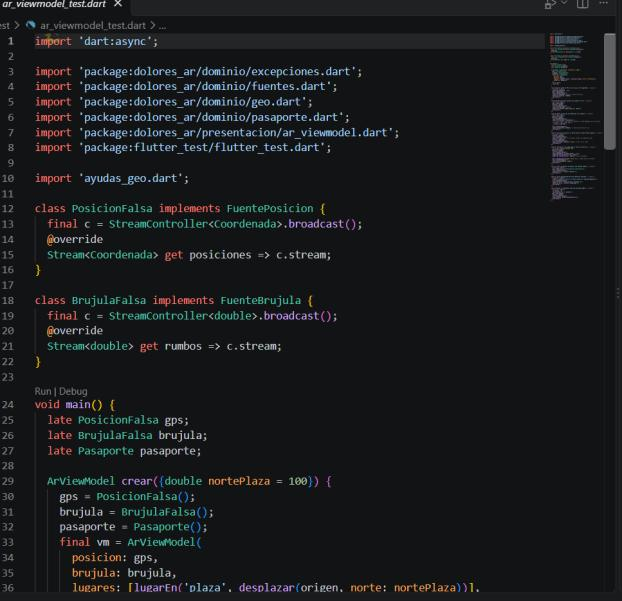

### Ronda 7 · Pantalla de RA

La pantalla es un `Stack` de capas (de atrás hacia adelante): **cámara → etiquetas → panel superior → controles de demo**.

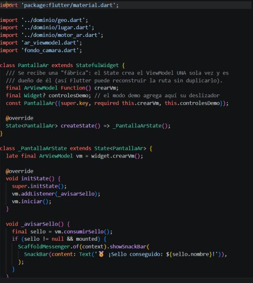
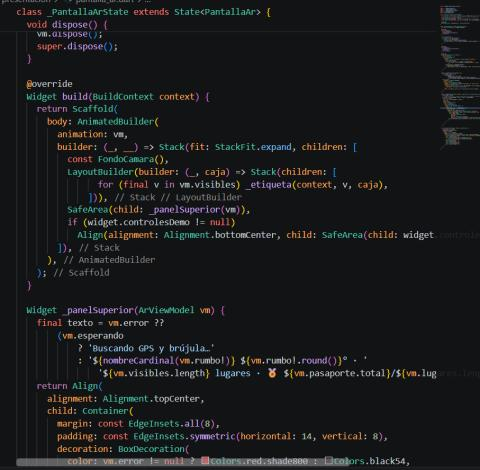
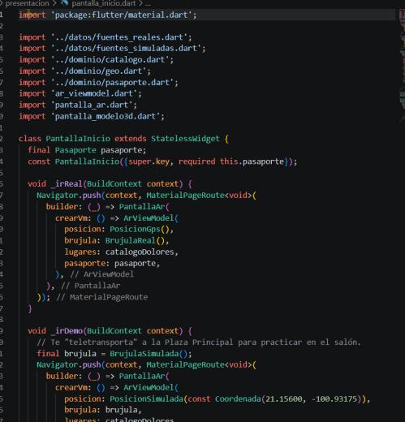
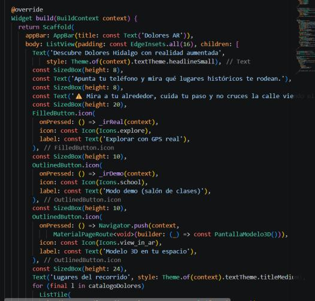
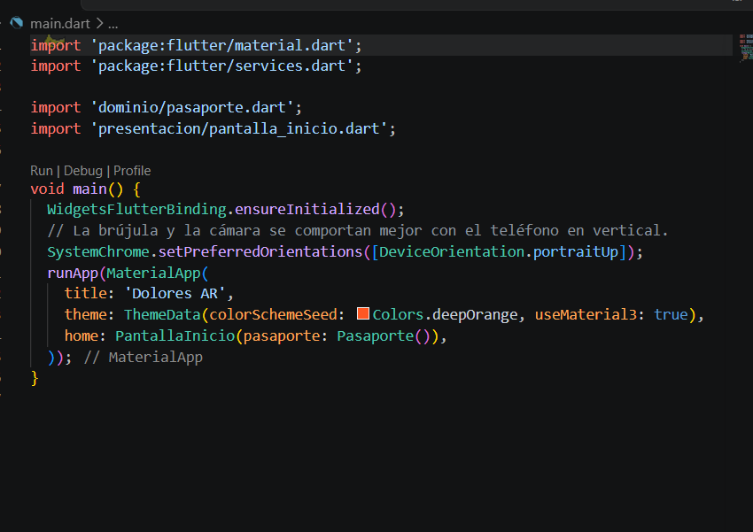

**Probar el modo demo:**

1. Toca **"Modo demo (salón de clases)"**: quedas "teletransportado" a la Plaza Principal.
2. Mueve el deslizador **"Gira"** y observa cómo aparecen y desaparecen las etiquetas.
3. Toca una etiqueta para ver su descripción y dato curioso.
4. Gana tu primer sello y regresa al inicio: los lugares visitados se marcan con una palomita.

### Ronda 8 · RA de superficie (modelo 3D)

`PantallaModelo3D` usa `ModelViewer` con `ar: true` y `arModes: ['scene-viewer', 'webxr', 'quick-look']`. Por defecto carga un astronauta de práctica desde internet; para tu app final guarda tu modelo en `assets/modelos/`, decláralo en `pubspec.yaml` y, para iPhone, agrega también una versión `.usdz` (`iosSrc`).

---

## 📡 Prueba de campo

Las coordenadas del catálogo se corrigen en el lugar:

1. Instala la app en un teléfono real.
2. Muestra temporalmente `usuario.toString()` en el panel superior.
3. Párate en la puerta de cada lugar, espera 30 s y anota las coordenadas.
4. Actualiza `catalogo.dart` con los valores medidos.

**Calibrar la brújula:** dibuja un "8" en el aire, aléjate de metales e imanes, mantén el teléfono casi vertical y ajusta `campoVision` (por ejemplo 55 o 70).

### Problemas comunes

| Síntoma | Solución |
|---------|----------|
| "Buscando GPS y brújula…" no termina | Revisa permisos, enciende el GPS y sal a cielo abierto. |
| Etiquetas que tiemblan | Baja `alfa` en `suavizarAngulo` (por ejemplo 0.1). |
| Etiquetas del lado contrario | Revisa el signo en `diferenciaAngular`. |
| Cámara negra | Falta permiso de cámara o estás en un emulador. |
| Batería baja muy rápido | Cancela suscripciones en `dispose()` y sube `distanceFilter`. |

---

## 🔒 Privacidad y seguridad

- Solo se pide ubicación **mientras se usa la app**.
- Todo el cálculo ocurre **dentro del teléfono**: no se envía la ubicación a ningún servidor.
- Los errores inesperados muestran un mensaje genérico, sin detalles internos.
- Aviso de seguridad al iniciar: *"Mira a tu alrededor, cuida tu paso y no cruces la calle viendo el teléfono"*.
- La lista de lugares funciona sin cámara, como alternativa accesible.

---

## ✅ Checklist de calidad

## Evidencia de pruebas

La suite valida cálculos geográficos, campo de visión, motor AR, pasaporte y ViewModel. Resultado: **42 pruebas aprobadas**.

### Ciclo TDD: rojo a verde

La captura roja reproduce de forma controlada el momento previo a implementar una regla; la verde corresponde a la suite final del repositorio.

| 🔴 Prueba que solicita código faltante | 🟢 Implementación terminada |
|---|---|
|  |  |

---

- [x] Toda la matemática vive en `dominio/` y no importa Flutter ni plugins.
- [x] Hay pruebas para distancia, rumbo, cruce del norte, campo de visión, ordenamiento, sellos y errores.
- [x] Las fuentes de GPS y brújula son contratos (se pueden simular y probar).
- [x] Existe un modo demo sin GPS ni brújula.
- [x] La app no se rompe sin cámara, sin permiso o sin brújula.
- [x] Se cancelan suscripciones y se libera la cámara en `dispose()`.

---

## 🏁 Retos para seguir mejorando

- 🔊 Guía de audio con `flutter_tts`.
- 💾 Persistencia del pasaporte con `shared_preferences`.
- 🌐 Descripciones desde la API de Wikipedia con caché.
- ➡️ Ruta guiada con una flecha al siguiente lugar sin visitar.
- ⚓ RA con anclas reales (`ar_flutter_plugin`).
- 🇺🇸 Versión en inglés con internacionalización de Flutter.
- 🎯 Mini mapa tipo radar.

---

## 👩‍💻 Autoría

Proyecto académico de **Desarrollo Móvil Integral** · Universidad Tecnológica del Norte de Guanajuato (UTNG).
Docente: **Anastacio Rodríguez García**.

> *La mejor realidad aumentada no reemplaza la mirada, la enriquece.*
