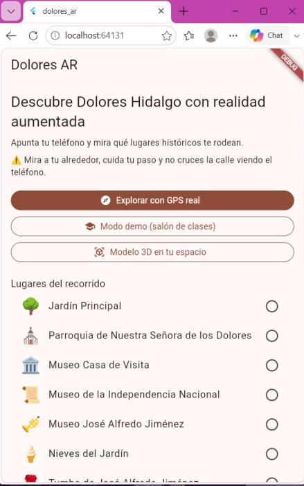

# Dolores AR

Dolores AR es una aplicación hecha en Flutter para mostrar lugares turísticos de Dolores Hidalgo usando ubicación, brújula y realidad aumentada.

La aplicación calcula distancias, muestra etiquetas sobre la cámara y permite ganar sellos al acercarse a los lugares.

## Captura de la aplicación



## Cómo ejecutarlo

```bash
flutter pub get
flutter run
```

Para ejecutar las pruebas:

```bash
flutter test
```

## Todas las pruebas

Se ejecutaron las siguientes 42 pruebas:

1. Sin GPS o brújula la aplicación queda esperando.
2. Con GPS y brújula calcula los lugares visibles.
3. Al girar la brújula se actualizan los lugares visibles.
4. La brújula se suaviza cuando hay un cambio brusco.
5. Al acercarse a un lugar se gana el sello una sola vez.
6. Un error de permiso muestra un mensaje sencillo.
7. Un error desconocido no muestra información interna.
8. La pantalla recibe una notificación cuando algo cambia.
9. Un grado de latitud mide aproximadamente 111.2 kilómetros.
10. La distancia del mismo punto es cero.
11. Un lugar al frente aparece en el centro.
12. La distancia entre dos puntos es simétrica.
13. Un desplazamiento de 300 y 400 metros da cerca de 500 metros.
14. El rumbo norte es cero grados.
15. El rumbo este es 90 grados.
16. El rumbo sur es 180 grados.
17. Un lugar a la derecha no aparece cuando se mira al norte.
18. El rumbo oeste es 270 grados.
19. Al girar al este el lugar aparece en el centro.
20. El rumbo noreste es 45 grados.
21. Al girar un poco la etiqueta se mueve al lado contrario.
22. Los ángulos se normalizan entre cero y 360 grados.
23. Los lugares fuera del radio máximo se descartan.
24. La diferencia angular toma el camino más corto.
25. La vista funciona al cruzar de 350 a 5 grados.
26. Suavizar un ángulo avanza poco a poco.
27. Los lugares lejanos se dibujan debajo de los cercanos.
28. El suavizado cruza correctamente de 350 a 10 grados.
29. Los lugares cercanos se ven más grandes.
30. Se obtiene el nombre del punto cardinal.
31. Un campo de visión ancho muestra más lugares.
32. Un lugar al frente cae en el centro de la pantalla.
33. Se reconoce el borde derecho del campo de visión.
34. Se reconoce el borde izquierdo del campo de visión.
35. Se reconoce un punto a medio camino.
36. Un lugar fuera del campo de visión no se dibuja.
37. Las distancias se muestran en metros o kilómetros.
38. Estar lejos de un lugar no entrega sello.
39. Estar a menos de 40 metros entrega el sello.
40. Estar exactamente a 40 metros todavía cuenta.
41. Cada sello se gana una sola vez.
42. El progreso representa la parte de lugares visitados.

Resultado final: **42 pruebas aprobadas**.

## Capturas reales de las pruebas

| Fase roja | Fase verde |
|---|---|
|  |  |
